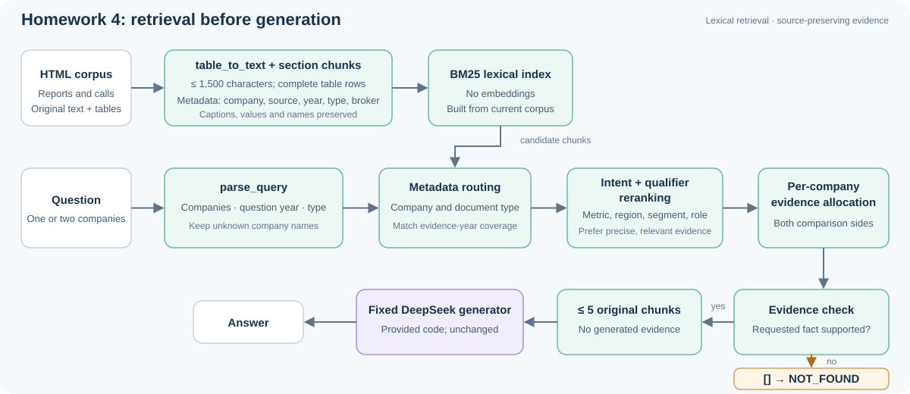

# FTEC5660 Homework 4

## Running

Use Python 3.10 or newer:

```bash
python3 -m venv .venv
source .venv/bin/activate
python3 -m pip install -r requirements.txt
cp .env.example .env
```

Set `DEEPSEEK_API_KEY` in `.env`, then run:

```bash
python3 hw4.py --data-folder public_test
```

This rebuilds the index and writes `results.csv`. To reproduce the experiments or run checks without model calls:

```bash
python3 run_ablation.py --output-dir experiments
python3 check_solution.py --data-folder public_test
```

Keep `.env` private.

## Homework 4 solution



HTML headings provide the company, reporting year and document type. `table_to_text()` preserves captions, column labels and printed values; section-aware chunking keeps table rows together and limits each chunk to 1,500 characters. Chunks carry `source`, `company`, `fiscal_year` and `doc_type` metadata, with section and broker context where relevant. BM25 indexes lexical tokens with light word normalisation. Query parsing identifies companies, the requested year and source type; metadata filtering accounts for prior-year table columns and future estimates. Reranking checks the financial metric and segment or region qualifier. Evidence allocation selects one passage per comparison subject and up to three for a single subject. Unsupported subjects or disclosures return `[]`; supported questions use the unchanged fixed generator. These choices preserve financial context and reduce company, year and metric confusion without embeddings.

### Ablation study

All configurations use the 60 public questions: 46 answerable and 14 unanswerable. Recall requires all evidence needed by an answerable question. Kept measures answerable questions receiving chunks; rejected measures unanswerable questions returning `[]`. Accuracy covers all questions.

**B0** uses BeautifulSoup `get_text()` without table conversion, `RecursiveCharacterTextSplitter(chunk_size=1500, chunk_overlap=150)`, required metadata, and global BM25 top-5 with lowercase whitespace tokens. It has no query parsing and never abstains. Each following row changes one component relative to the previous row. V2's chunker includes contextual headers; V6's allocation policy includes both comparison quotas and the single-subject passage cap.

| Variant | Change | Recall@5 | Kept | Rejected | Accuracy |
|---|---|---:|---:|---:|---:|
| B0 | Naive baseline | 28.26% | 100% | 0% | 46.67% |
| V1 | Table linearisation | 28.26% | 100% | 0% | 45.00% |
| V2 | Section/table-aware chunks and headers | 80.43% | 100% | 0% | 83.33% |
| V3 | Lexical tokenisation | 91.30% | 100% | 0% | 86.67% |
| V4 | Company/type/year filtering | 93.48% | 100% | 71.43% | 93.33% |
| V5 | Metric and qualifier reranking | 100% | 100% | 71.43% | 100% |
| V6 | Evidence allocation by subject | 100% | 100% | 71.43% | 100% |
| V7 | Evidence-based abstention | 100% | 100% | 100% | 100% |

- **V1:** table conversion alone leaves global ranking errors unresolved. Changed split boundaries and token frequencies can also hurt retrieval, so accuracy falls slightly.
- **V2:** keeping rows and local context together raises complete evidence hits from 13 to 37 out of 46.
- **V3:** word normalisation improves matching to 42 hits, but similar company names still cause false positives.
- **V4:** explicit entity and source filtering rejects ten unsupported company/year questions and reduces cross-company errors.
- **V5:** matching the exact metric, qualifier and reporting period recovers the remaining evidence and resolves ambiguous comparisons.
- **V6:** accuracy stays unchanged, while returned passages fall from 250 to 138. Comparison coverage is explicit and contexts are shorter.
- **V7:** the generator already refuses the remaining four unsupported disclosures. Earlier rejection preserves accuracy, raises Task 3 from 7.14/10 to 10/10, and avoids four generator calls per uncached run.

Per-question outputs and contexts are saved in `experiments/`; the combined table is `experiments/summary.csv`. Only actual generator responses with identical full inputs are cached. Timings include cache lookups and are not cold-start comparisons. Version fingerprints prevent incompatible results from being combined.

### Error analysis

- **Wrong source:** B0 misses the net-receivables evidence in `q051`. Structured tables and company/year filtering recover it.
- **Ambiguous evidence:** V4 has the required evidence for comparison `q022` but answers incorrectly. Metric and period reranking resolves it in V5.
- **Missing qualifier:** `q033` asks for largest-customer revenue, which total revenue cannot establish. V7 returns `[]` instead of relying on the generator to refuse.
- **Broker attribution:** a development version omitted the broker label from target-price passages in `q035`. Retaining that source context fixed the resulting refusal.

### Validation

All 12 table checks and 40 document checks pass. A clean-clone run produces **60/60 correct public answers and 75/75 automated points** in 5.6 seconds. Five additional paraphrase regression cases also pass. Records are in `fresh_clone_verification.log` and `experiments/audit/`. These public results do not guarantee private-set performance; unfamiliar wording remains a limitation of rule-based parsing.

## Task 6: Reflection

See [reflection.md](reflection.md).
